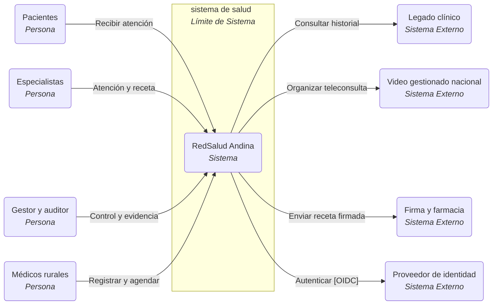
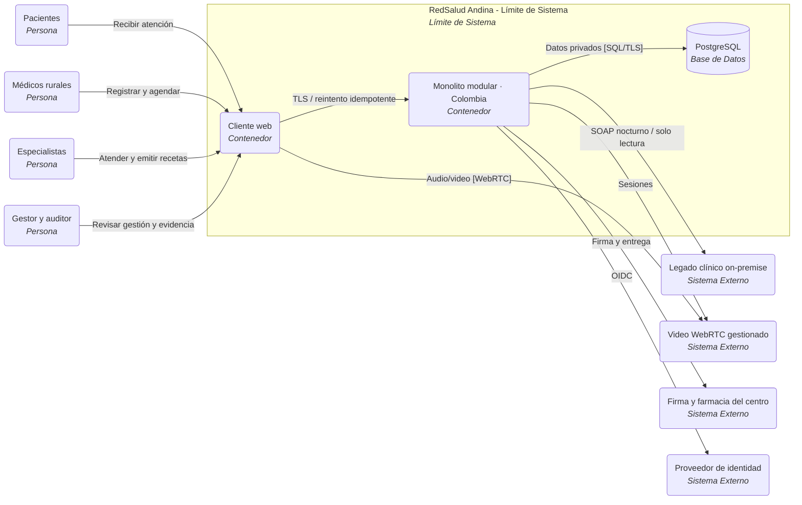
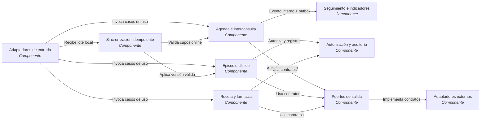
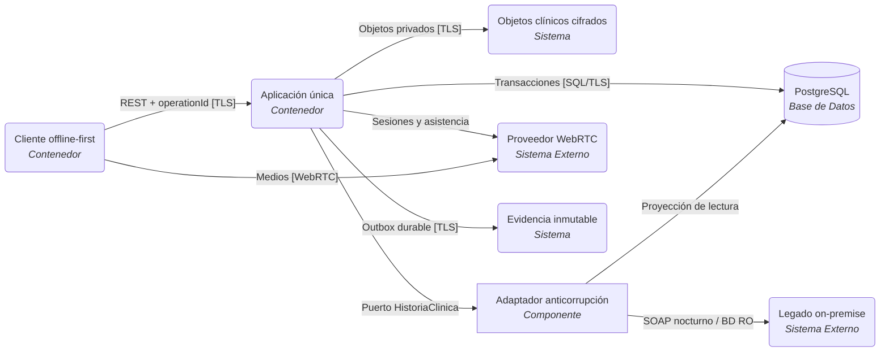
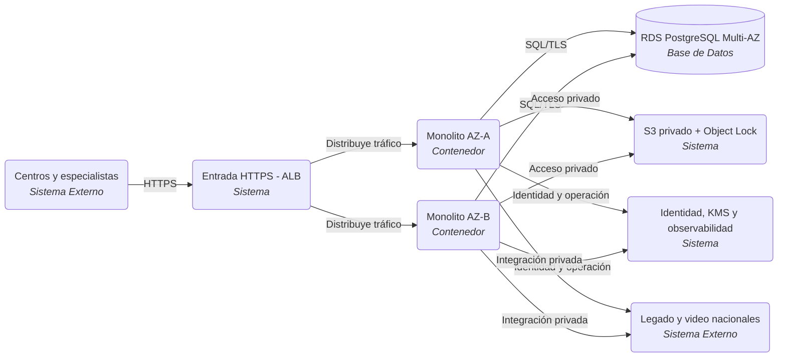
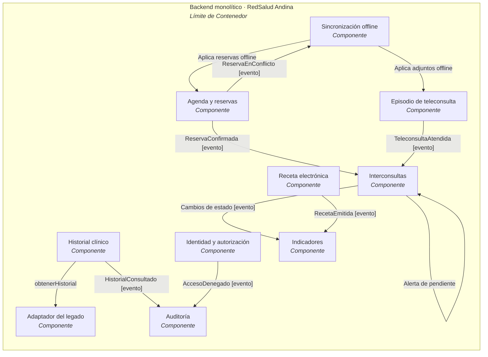
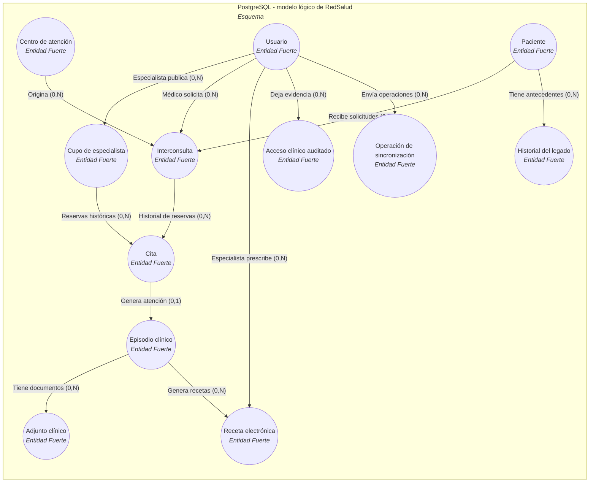

# RedSalud Andina — Arquitectura C4 y Vistas Diferenciadas

**Proyecto:** `RedSalud Andina - Arquitectura` · **Stack:** Java 21 (LTS), Spring Boot 3.x, React/PWA, AWS (Región única)
**Postura arquitectónica:** Monolito modular con contextos delimitados (límites verificables con `ArchUnit` / `Spring Modulith`), extrayendo únicamente señalización de video gestionada (`WebRTC`) e ingesta/archivado inmutable de auditoría (`S3 Object Lock`).

## 1. Decisiones arquitectónicas cerradas (ADRs)
- **ADR-001 (Monolito modular):** un módulo por contexto delimitado con esquema propio en Aurora PostgreSQL Multi-AZ; DynamoDB únicamente para perfiles de identidad y caché del legado; comunicación interna por eventos (prohibido `@ManyToOne` y `JOIN` entre módulos).
- **ADR-002 (Frontera legado ACL + CQRS):** adaptador anticorrupción frente a SOAP nocturno + BD solo lectura; vista de lectura con caché L1/L2 (`Caffeine` + `ElastiCache/DynamoDB`) y cabecera `X-Data-Freshness` (`p95 <= 2 s` caché / `<= 6 s` directo).
- **ADR-003 (Offline-first e idempotencia):** cliente con UUID/ULID + sello del centro, `Idempotency-Key` persistida con restricción `UNIQUE`, *Transactional Outbox* + `SQS FIFO` ordenado por agregado, conflictos LWW con doble auditoría en lo asistencial y rechazo contra servidor en cupos/recetas firmadas.
- **ADR-004 y ADR-005 (Residencia y auditoría demostrable):** región AWS única sin réplicas ni backups externos, cifrado TLS + KMS con claves por contexto y rotación, autorización ABAC (`@PreAuthorize` + `AuthorizationManager`) en capa de servicio y auditoría *append-only* en `S3 Object Lock (Compliance)` con reporte reproducible.

## 2. Matriz de requisitos de calidad (ASR-1 a ASR-9)
| ID | Atributo | Escenario | Métrica objetivo | Decisión arquitectónica |
| --- | --- | --- | --- | --- |
| ASR-1 | Disponibilidad | Corte de enlace rural (5/14 centros, 2 Mbps) | Continuidad local; `0` pérdida; sync `<= 15 min` | Cliente offline-first + cola local + API idempotente |
| ASR-2 | Disponibilidad | Falla nodo cómputo en horario atención | Disponibilidad `>= 99,5 %` mensual | Multi-AZ (AZ-A/AZ-B), ALB, auto scaling, health checks |
| ASR-3 | Rendimiento | Especialista abre historial legado | `p95 <= 2 s` caché; `<= 6 s` consulta directa | Capa anticorrupción + caché lectura CQRS |
| ASR-4 | Rendimiento | Pico de 40 teleconsultas simultáneas | Señalización `<= 300 ms`; sin servidor video propio | Servicio gestionado WebRTC regional |
| ASR-5 | Seguridad | Usuario sin rol clínico intenta leer historia | Denegación `100 %` + registro auditoría | ABAC en servicio + TLS/KMS + S3 Object Lock |
| ASR-6 | Seguridad | Acceso clínico fuera del país | Bloqueo por política; residencia garantizada | Región única AWS sin réplicas cross-region |
| ASR-7 | Mantenibilidad | Cambio de proveedor del legado | Aislado en `<= 1` módulo sin tocar dominio | Puerto `HistorialClinicoPort` + adaptador ACL |
| ASR-8 | Mantenibilidad | Nuevo canal (app móvil paciente) | Reutilizar `>= 80 %` servicios de dominio | Monolito modular con límites `ArchUnit` |
| ASR-9 | Mantenibilidad | Despliegue sin ventana mantenimiento | Automatizado; rollback `<= 10 min` | CI/CD + IaC + observabilidad Micrometer/OTel |

## 3. Diagrama de Contexto (`Modelo`)

## 4. Contenedores

## 5. Vista Lógica (Hexagonal)

## 6. Vista Física y de Datos

## 7. Vista de Despliegue (Multi-AZ · Región Única)

## 8. Componentes del Backend

## 9. Modelo Lógico de Base de Datos (MER)

