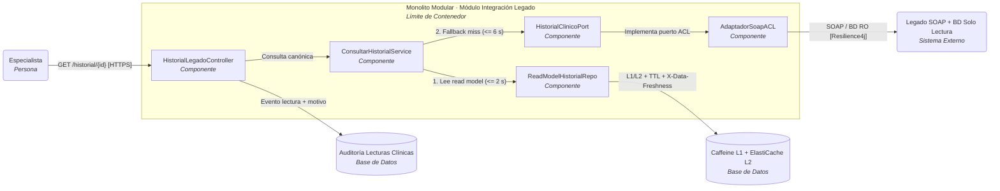
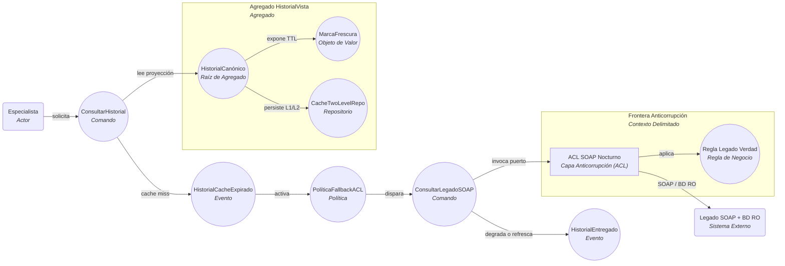
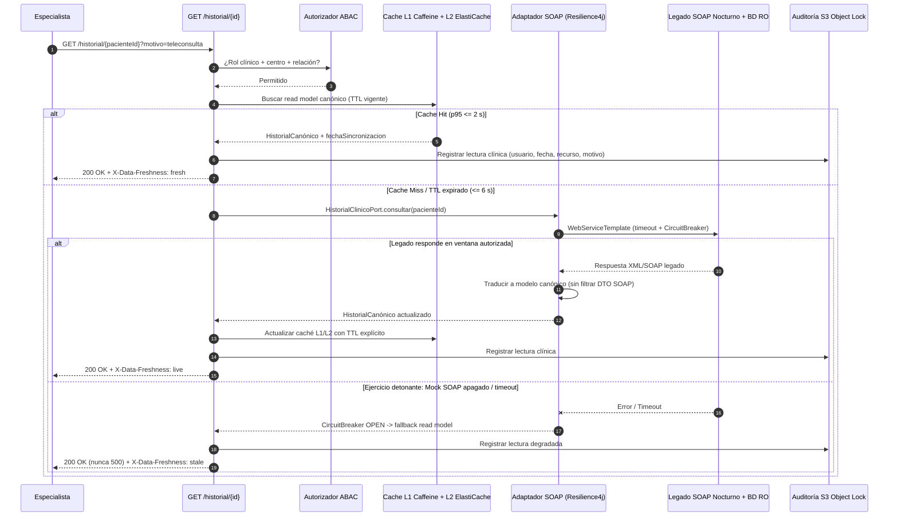

# Frontera con el Legado: Adaptador Anticorrupción (Sesión 2)

**Proyecto ProcessFlow:** `redSaludAndina_ACL_Legado` · **ADR asociado:** `ADR-002` · **RF cubierto:** `RF-06`

## 1. Decisión arquitectónica y métricas objetivo
- **Regla dura:** el sistema legado no se modifica y es la fuente de verdad del historial clínico (expone únicamente SOAP nocturno y base de datos de solo lectura). Nuestra vista es una copia de lectura con caducidad visible.
- **Patrón:** CQRS con *read model* propio (`Caffeine L1` + `ElastiCache/DynamoDB L2`), puerto de dominio `HistorialClinicoPort`, adaptador SOAP con `WebServiceTemplate` + timeouts + `Resilience4j` (`@CircuitBreaker`) y cabecera `X-Data-Freshness` en `GET /historial/{id}`.
- **Criterios de aceptación:** `p95 <= 2 s` con caché; `<= 6 s` en consulta directa; **ejercicio detonante:** al apagar el mock SOAP el endpoint sigue respondiendo desde el *read model* con frescura visible (nunca HTTP `500`); cambio de proveedor aislado en `<= 1` módulo (`legado.infraestructura.salida.soap`).

## 2. Mapa de traducción: Modelo Legado (SOAP) vs. Modelo Canónico
| Campo en Legado SOAP / BD RO | Campo Canónico (`HistorialClinicoCanonico`) | Regla de traducción en `AdaptadorSoapACL` |
| --- | --- | --- |
| `COD_PAC_HIST` (string propietario) | `pacienteId` (`UUID`) | Traducido en ACL mediante tabla de correlación; nunca se filtra código legado al dominio |
| `XML_RESUMEN_ANT` / `OBS_CLN` | `resumenAntecedentes` (`String` minimizado) | Normalizado y minimizado a datos pertinentes; se descartan campos administrativos |
| `FEC_ULT_CARGA_NOCT` | `fechaSincronizacion` (`Instant`) | Publicado en cabecera HTTP `X-Data-Freshness` |
| Estado circuito / origen | `degradadoDesdeCache` (`boolean`) | `true` cuando `CircuitBreaker` está abierto o SOAP fuera de ventana |

## 3. Arquitectura de la Capa Anticorrupción (C4)

## 4. Modelo Táctico DDD y Event Storming

## 5. Secuencia: Caché, Fallback y Ejercicio Detonante (Mock SOAP Apagado)

