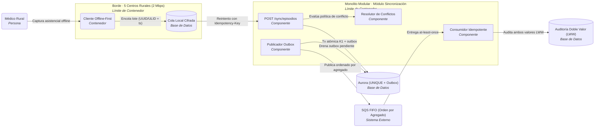
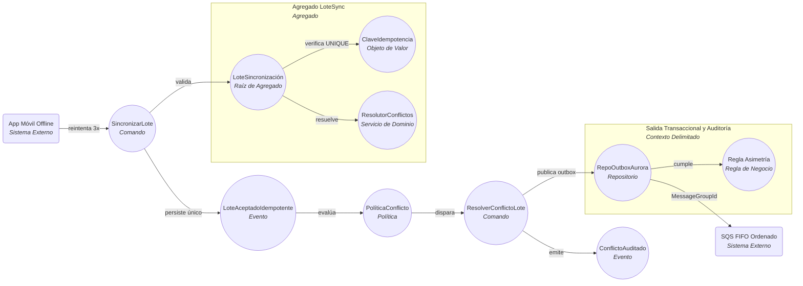
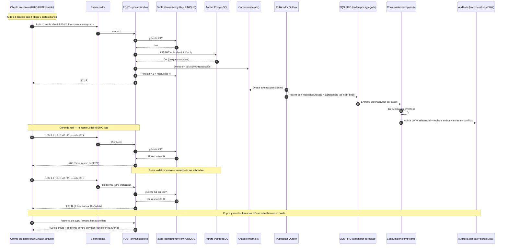

# Offline-First e Idempotencia (Sesión 3)

**Proyecto ProcessFlow:** `redSaludAndina_Offline_Idempotencia` · **ADR asociado:** `ADR-003` · **RF cubiertos:** `RF-09`, `RF-03`

## 1. Modelo de sincronización del borde (5 de 14 centros con 2 Mbps y cortes diarios)
| Garantía exigida | Mecanismo implementado | Criterio verificable |
| --- | --- | --- |
| **No duplicar episodios** | `UUID/ULID` estable generado en cliente + `Idempotency-Key` persistida + `UNIQUE` en Aurora | `POST /sync/episodios` sobrevive reinicio de proceso (nunca `if exists` en memoria) |
| **No perder eventos** | *Transactional Outbox* en misma transacción de Aurora + `SQS FIFO` (`MessageGroupId = agregadoId`) + consumidor idempotente | Sincronización `<= 15 min` tras reconexión y `0` pérdida (verificado con Testcontainers) |
| **Resolver conflictos sin destruir evidencia** | *Last-writer-wins* por campo independiente en lo asistencial + ambos valores en auditoría | Ningún dato asistencial en conflicto se sobrescribe en silencio |
| **Preservar consistencia fuerte** | Rechazo (`409`) y reintento contra servidor para cupos y recetas firmadas | Cero doble reserva y cero modificación de recetas firmadas en el borde |

## 2. Tabla asimétrica de resolución de conflictos (Bloque 3.4)
| Tipo de dato / operación | ¿Se resuelve en el borde? | Política aplicada | Evidencia en auditoría |
| --- | --- | --- | --- |
| Nota de evolución / signos vitales | Sí (campos independientes) | *Last-writer-wins* con sello de tiempo del centro | **Ambos valores** (ganador + desplazado) quedan registrados |
| Adjunto de examen / imagen | Sí (idempotente por ULID) | Anexado único por clave idempotente | Hash, usuario, centro y sello temporal |
| Reserva / cambio de cupo especialista | **No** | **Rechazo** en borde y reintento online contra servidor (`@Version`) | Registro de conflicto de cupo para reprogramación |
| Emisión o cambio de receta firmada | **No** | **Rechazo** en borde y validación/firma online con KMS | Intento rechazado auditado sin emitir borrador |

## 3. Arquitectura Borde + Nube (C4)

## 4. Modelo Táctico DDD y Event Storming (`Agregado LoteSync`)

## 5. Secuencia: Triple Envío, Reinicio de Proceso y Conflictos

