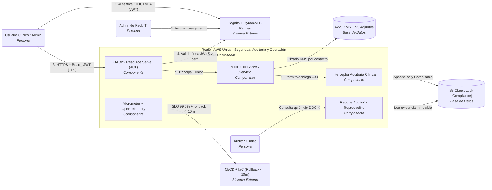
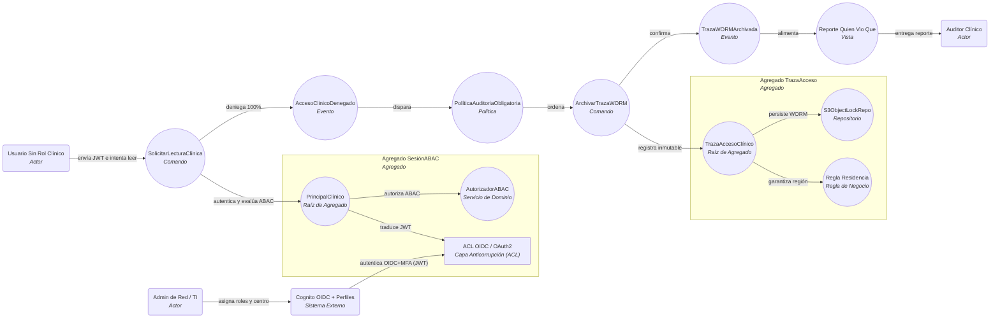
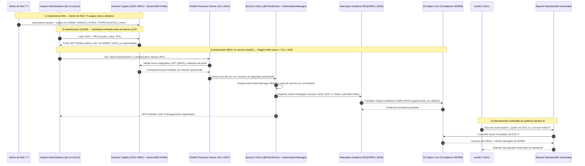
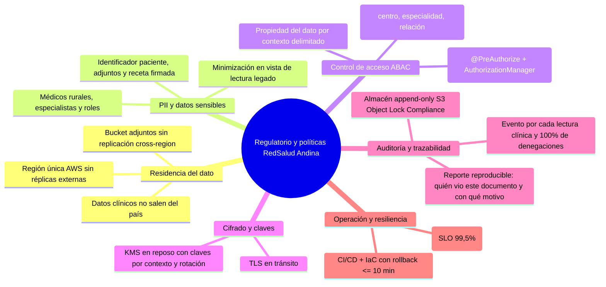

# Seguridad, Auditoría Demostrable y Operación (Sesión 4)

**Proyecto ProcessFlow:** `redSaludAndina_Seguridad_Auditoria_Operacion` · **ADRs asociados:** `ADR-004`, `ADR-005` · **RF cubiertos:** `RF-01`, `RF-08`, `RF-10`

## 1. Controles de seguridad, residencia y cumplimiento
| Dimensión | Mecanismo arquitectónico | Evidencia de aceptación |
| --- | --- | --- |
| **Asignación de roles (IAM)** | **Admin de Red / TI** aprovisiona usuarios y asigna roles (`MEDICO_RURAL`, `ESPECIALISTA`, `AUDITOR`, `ADMIN`) y atributos (`centro_id`, `especialidad`) en **Amazon Cognito + DynamoDB Perfiles** | Ningún usuario se autoasigna roles; perfiles gestionados con consistencia fuerte |
| **Autenticación (AuthN)** | El usuario inicia sesión con **OIDC + MFA** en **Amazon Cognito** y obtiene un **JWT firmado**; en el backend, **OAuth2 Resource Server (ACL)** verifica firma JWKS y traduce claims a `PrincipalClínico` | Tokens inválidos o sin firma JWKS rechazados en frontera (`401`); claims aislados en `identidad.infraestructura` |
| **Autorización ABAC (AuthZ)** | `@PreAuthorize` + `AuthorizationManager` propio por **rol y atributo** (`centro`, `especialidad`, `relación con paciente`, `motivo`) evaluado en **capa de servicio** | Test negativo: usuario administrativo recibe `403` y el `100 %` de denegaciones queda auditado |
| **Cifrado y residencia** | TLS en tránsito + AWS KMS con claves por contexto y rotación; bucket S3 en región única sin replicación cross-region | Configuración + test de política de bucket bloqueando réplicas externas |
| **Auditoría demostrable** | Evento por cada lectura clínica (`usuario`, `fecha`, `recurso`, `motivo`, `permitido`) en almacén *append-only* `S3 Object Lock (Compliance)` en transacción independiente | Script reproducible + salida versionada: *"quién vio el documento X y con qué motivo"* |
| **Observabilidad y SLO** | `Micrometer` + `OpenTelemetry` + `Actuator` + `Prometheus` + export analítico S3/Athena | Dashboard mínimo sosteniendo SLO `>= 99,5 %` mensual |
| **Operación CI/CD** | Pipeline automatizado con `ArchUnit`, `Testcontainers`, cobertura `>= 70 %` e IaC | Despliegue sin ventana y *rollback* `<= 10 min` |

## 2. Arquitectura de Seguridad, Auditoría y Operación (C4)

## 3. Modelo Táctico DDD y Event Storming (`SesiónABAC` + `TrazaAcceso`)

## 4. Secuencia: Ejercicio Detonante — Denegación Auditada y Reporte Reproducible

## 5. Mapa Regulatorio y Políticas del Dato Clínico

