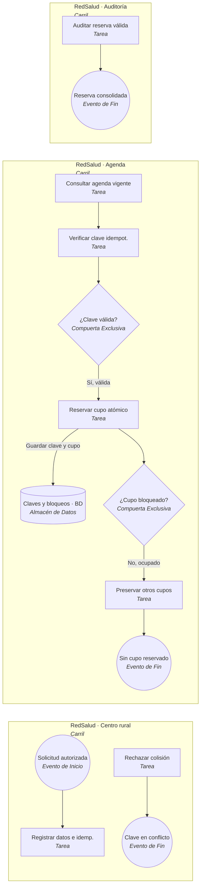
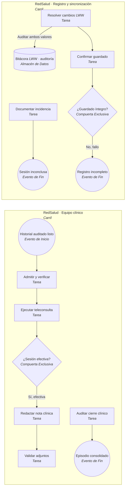
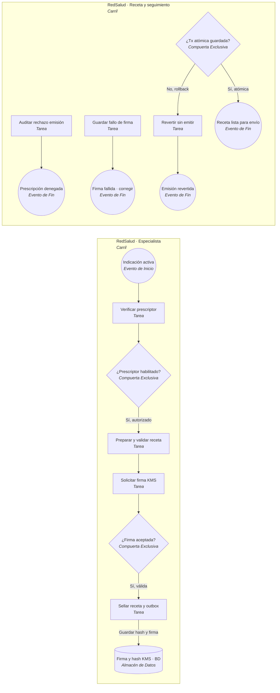
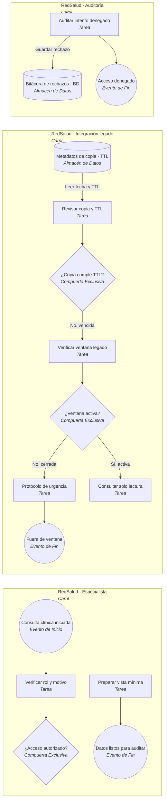

# RedSalud Andina — Procesos BPMN, Fichas, Mecánica de Trabajo y Acta de Divergencias

**Proyecto:** `redSaludAndina_procesos` · **Notación:** BPMN 2.0 (Pools, Carriles, Compuertas Exclusivas, Eventos de Error/Temporizador y 4 Subprocesos enlazados con `viewRef`)
**Criterio de trazabilidad (Bloque 7):** **39 de 39 tareas** con contexto dueño, dato, evento y camino de excepción declarados (**tareas huérfanas = 0**).

## 1. Mecánica de trabajo y rotación de roles (120 min)
| Bloque | Proceso / Actividad | Modelador | Escéptico | Escriba | Producto verificado |
| --- | --- | --- | --- | --- | --- |
| 1–2 | Arranque, Pool `RedSalud` y pools externos (`Paciente`, `Legado`, `Farmacia`) | Integrante A | Integrante B | Integrante C | Pool con carriles + 3 pools externos |
| 3 | Proceso 1: `01 · Agendamiento` | Integrante B | Integrante C | Integrante A | Subproceso con `viewRef`, idempotencia y bloqueo atómico |
| 4 | Proceso 2: `02 · Atención y registro` (online/offline) | Integrante C | Integrante A | Integrante B | Compuerta `¿Hay conexión?`, cola local y `Resolver cambios LWW` |
| 5 | Proceso 3: `03 · Prescripción` | Integrante A | Integrante B | Integrante C | Compuerta dura firma KMS + tx atómica outbox hacia SQS |
| 6 | Proceso 4: `04 · Consulta del historial` | Integrante B | Integrante C | Integrante A | Vista propia TTL vs. ventana legado + auditoría de denegaciones |
| 7–8 | Coherencia BPMN ↔ DDD, exportación y acta | Equipo completo | Equipo completo | Equipo completo | `0` tareas huérfanas + Mermaid + Markdown + PDF + Acta |

## 2. Matriz de coherencia 1:1 BPMN ↔ DDD (Bloque 7)
| Subproceso BPMN (`viewRef`) | Contraparte DDD / Proyecto dedicado | Comandos y Políticas espejo | Consistencia |
| --- | --- | --- | --- |
| `01 · Agendamiento` | `redSaludAndina_DDD` → `01 · Agenda e Interconsulta` | `SolicitarInterconsulta`, `InterconsultaSolicitada`, `PolíticaReservaCupo`, `ReservarCupo`, `CupoReservado` | Fuerte (`@Version` / bloqueo atómico) |
| `02 · Atención y registro` | `redSaludAndina_DDD` → `02 · Episodio y Sync Offline` + `redSaludAndina_Offline_Idempotencia` | `SincronizarLote`, `LoteAceptadoIdempotente`, `PolíticaConflicto`, `ResolverConflictoLote`, `ConflictoAuditado` | Fuerte en agregado + LWW asistencial auditado |
| `03 · Prescripción` | `redSaludAndina_DDD` → `03 · Receta, KMS y Outbox` | `EmitirReceta`, `FirmaKMS`, `RepoRecetaOutbox`, `PL Contrato SQS`, `RecetaEntregadaAFarmacia` | Fuerte local + eventual hacia farmacia (SQS) |
| `04 · Consulta del historial` | `redSaludAndina_DDD` → `04 · ACL Legado y Auditoría` + `redSaludAndina_ACL_Legado` + `redSaludAndina_Seguridad_Auditoria_Operacion` | `ConsultarHistorial`, `PolíticaFallbackACL`, `ConsultarLegadoSOAP`, `SolicitarLecturaClínica`, `AccesoClinicoDenegado`, `ArchivarTrazaWORM` | Eventual con TTL visible + Auditoría inmutable |

## 3. Ficha obligatoria completa de las 39 tareas BPMN
| Vista | Tarea | Contexto dueño | Dato que produce | Evento que emite | Camino de excepción |
| --- | --- | --- | --- | --- | --- |
| Modelo | `Solicitar cita` | Interconsulta | SolicitudCita(pacienteId, centroRuralId, especialidad) | `SolicitudCitaEnviada` | Datos incompletos -> Solicitud rechazada |
| Modelo | `Leer fuente autorizada` | Integración legado | AntecedentesLegado(pacienteId, origen, fecha) | `LecturaLegadoRespondida` | ¿Lectura disponible? = No -> Informar indisponibilidad |
| Modelo | `Recibir receta firmada` | Receta | AcuseFarmacia(recetaId, hashFirma, estado) | `RecepcionFarmaciaProcesada` | ¿Recepción guardada? = No -> Informar error de recepción |
| Modelo | `Validar al paciente` | Identidad y acceso | PrincipalClinico + relacionAsistencial | `PacienteValidado` | ¿Datos válidos? = No -> Solicitud rechazada |
| Modelo | `Ofrecer alternativa` | Agenda | PropuestaReprogramacion(pacienteId, franjas) | `AlternativaReprogramacionOfrecida` | Sin cupo disponible -> Cita por reprogramar |
| Modelo | `Revisar cita asignada` | Agenda | CitaConfirmada(citaId, cupoId, centroRuralId) | `CitaPreparadaParaAtencion` | Sin conexión -> compuerta ¿Hay conexión? desvía a borrador local |
| Modelo | `Guardar borrador local` | Sincronización | BorradorLocalOffline(ulid, selloCentro, payload) | `BorradorOfflineEncolado` | Fallo de disco local -> conserva borrador sin simular teleconsulta |
| Modelo | `Sincronizar el borrador` | Sincronización | LoteSincronizacion(idempotencyKey, operaciones) | `LoteSincronizado` | Conflicto cupo/receta -> rechazo contra servidor; LWW asistencial -> doble auditoría |
| Modelo | `Registrar auditoría` | Auditoría | EventoAuditoriaClinica(usuario, fecha, recurso, motivo, resultado) | `LecturaClinicaAuditada` | ¿Auditoría guardada? = No -> Fallo al guardar auditoría (bloquea entrega) |
| Modelo | `Entregar a farmacia` | Receta | OrdenEnvioFarmacia(recetaId, estadoEntrega) | `RecetaEntregadaAFarmacia` | ¿Farmacia confirmó? = No -> Esperar reintento (outbox/SQS) |
| 01 · Agendamiento | `Registrar datos e idemp.` | Interconsulta | Interconsulta solicitada | `InterconsultaSolicitada` | Si faltan datos obligatorios no se intenta reservar. |
| 01 · Agendamiento | `Rechazar colisión` | Agenda | Conflicto idempotente | `ClaveRechazada` | Preserva intacta la reserva original si existía. |
| 01 · Agendamiento | `Consultar agenda vigente` | Agenda | Disponibilidad de especialistas | `DisponibilidadConsultada` | Otro centro puede ocupar la franja tras consultar. |
| 01 · Agendamiento | `Verificar clave idempot.` | Agenda | Clave idempotente y hash | `ClaveVerificada` | La misma clave con contenido diferente se rechaza. |
| 01 · Agendamiento | `Reservar cupo atómico` | Agenda | Reserva y clave atómica | `ReservaProcesada` | Sin red no declara reserva confirmada; concurrencia falla sin liberar cupos ajenos. |
| 01 · Agendamiento | `Preservar otros cupos` | Agenda | Motivo de rechazo atómico | `CupoNoDisponible` | Cierra limpio para ofrecer alternativa en Modelo. |
| 01 · Agendamiento | `Auditar reserva válida` | Auditoría | Evidencia de reserva | `ReservaAuditada` | Una evidencia pendiente permanece recuperable. |
| 02 · Atención y registro | `Admitir y verificar` | Episodio clínico | Admisión de teleconsulta | `PacienteAdmitido` | Sin autorización vigente impide abrir sesión. |
| 02 · Atención y registro | `Ejecutar teleconsulta` | Episodio clínico | Signos y asistencia real | `TeleconsultaEjecutada` | Una captura offline nunca simula asistencia remota. |
| 02 · Atención y registro | `Redactar nota clínica` | Episodio clínico | Evolución clínica | `EvolucionRedactada` | Sin nota válida no se cierra la atención. |
| 02 · Atención y registro | `Validar adjuntos` | Episodio clínico | Metadatos de adjunto | `AdjuntosVerificados` | Un adjunto incompleto no se declara disponible. |
| 02 · Atención y registro | `Auditar cierre clínico` | Auditoría | Evidencia de cierre | `AtencionAuditada` | No oculta incidencias técnicas previas. |
| 02 · Atención y registro | `Documentar incidencia` | Episodio clínico | Causa de interrupción | `IncidenciaRegistrada` | Mantiene el caso listo para reprogramación en Modelo. |
| 02 · Atención y registro | `Resolver cambios LWW` | Episodio clínico | Delta de campos y LWW | `ConflictosLWWResueltos` | Nunca descarta el valor previo sin trazabilidad. |
| 02 · Atención y registro | `Confirmar guardado` | Episodio clínico | Registro confirmado | `RegistroConfirmado` | Un fallo antes del commit no declara éxito. |
| 04 · Consulta del historial | `Verificar rol y motivo` | Identidad y acceso | Decisión y motivo clínico | `AccesoClinicoEvaluado` | Sin motivo o relación válida bloquea cualquier lectura. |
| 04 · Consulta del historial | `Preparar vista mínima` | Integración legado | Paquete mínimo trazable | `VistaMinimaPreparada` | Modelo ejecuta auditoría durable antes de mostrar al especialista. |
| 04 · Consulta del historial | `Revisar copia y TTL` | Integración legado | Frescura de copia | `CopiaEvaluada` | Una copia caducada nunca se presenta como actual. |
| 04 · Consulta del historial | `Verificar ventana legado` | Integración legado | Estado de ventana | `VentanaVerificada` | No promete SOAP diurno fuera de ventana. |
| 04 · Consulta del historial | `Protocolo de urgencia` | Integración legado | Motivo fuera de ventana | `VentanaCerradaReportada` | Protocolo de urgencia pendiente de definición. |
| 04 · Consulta del historial | `Consultar solo lectura` | Integración legado | Antecedentes traducidos | `LegadoConsultado` | Indisponibilidad explícita si el legado falla. |
| 04 · Consulta del historial | `Auditar intento denegado` | Auditoría | Evidencia de denegación | `LecturaDenegada` | Un fallo de archivo conserva el intento durable. |
| 03 · Prescripción | `Verificar prescriptor` | Identidad y acceso | Permiso de prescripción | `PrescriptorValidado` | No concede permisos ante fallo de identidad. |
| 03 · Prescripción | `Preparar y validar receta` | Receta | Borrador verificado | `RecetaPreparada` | Un borrador incompleto bloquea la firma y nunca se emite. |
| 03 · Prescripción | `Solicitar firma KMS` | Receta | Firma digital y hash | `FirmaSolicitada` | Sin red o certificado válido la receta sigue sin emitirse. |
| 03 · Prescripción | `Sellar receta y outbox` | Receta | Receta y orden outbox | `RecetaConfirmadaTx` | Una caída previa al commit deja cero recetas emitidas a medias. |
| 03 · Prescripción | `Auditar rechazo emisión` | Auditoría | Denegación y motivo | `PrescripcionDenegada` | Cierra limpio hacia Receta no emitida en Modelo. |
| 03 · Prescripción | `Guardar fallo de firma` | Receta | Borrador y error de firma | `FirmaRechazada` | Impide crear entrada en outbox de farmacia. |
| 03 · Prescripción | `Revertir sin emitir` | Receta | Fallo transaccional | `TxAbortada` | Nunca publica orden en outbox si falló el commit. |

## 4. Acta de divergencias frente a la propuesta base (Bloque 8)
1. **Sincronización como módulo de soporte explícito:** además de los 8 contextos del mapa de datos, `Sincronización` actúa como borde idempotente (`UUID/ULID`, `Idempotency-Key` y *outbox*) sin apropiarse de las tablas de `Agenda` ni `Episodio`.
2. **Auditoría bloqueante en lectura clínica:** si `Registrar auditoría` falla (`¿Auditoría guardada? = No`), el flujo dispara `Fallo al guardar auditoría` y bloquea la entrega de datos clínicos en vez de degradar en silencio.
3. **Separación de estados en farmacia:** `Receta emitida` (commit atómico receta firmada + outbox) y `Receta entregada` (confirmación de farmacia vía SQS con reintentos) son eventos distintos.
4. **Rechazo estricto en el borde para cupos y recetas:** sin conectividad no se simula videollamada ni se firma receta; los conflictos sobre cupos o recetas se rechazan y requieren reintento contra servidor.

## 5. Código Mermaid — Proceso General (`Modelo`)

```mermaid
flowchart LR
  subgraph agg_Paciente___solicitud_y_notificaci_n["paciente<br/><i>Pool</i>"]
    general_v2_pedir_cita["Solicitar cita<br/><i>Tarea</i>"]
    general_v2_notificacion(("Recibir respuesta de cita<br/><i>Evento de Mensaje</i>"))
    general_v2_fin_paciente(("Respuesta recibida<br/><i>Evento de Fin</i>"))
  end
  subgraph agg_Legado___consulta_autorizada["Legado · consulta autorizada<br/><i>Pool</i>"]
    general_v2_consulta_externa["Leer fuente autorizada<br/><i>Tarea</i>"]
    general_v2_legado_disponible{"¿Lectura disponible?<br/><i>Compuerta Exclusiva</i>"}
    general_v2_legado_ok(("Devolver antecedentes<br/><i>Evento de Fin</i>"))
    general_v2_legado_no(("Informar indisponibilidad<br/><i>Evento de Fin</i>"))
  end
  subgraph agg_Farmacia___recibir_y_confirmar["Farmacia · recibir y confirmar<br/><i>Pool</i>"]
    general_v2_recibir_receta["Recibir receta firmada<br/><i>Tarea</i>"]
    general_v2_farmacia_guardada{"¿Recepción guardada?<br/><i>Compuerta Exclusiva</i>"}
    general_v2_farmacia_ok(("Confirmar recepción<br/><i>Evento de Fin</i>"))
    general_v2_farmacia_no(("Informar error de recepción<br/><i>Evento de Fin</i>"))
  end
  subgraph general_v2_lane_0["Centro rural · solicitud<br/><i>Carril</i>"]
    general_v2_inicio(("Solicitud recibida<br/><i>Evento de Inicio</i>"))
    general_v2_validar["Validar al paciente<br/><i>Tarea</i>"]
    general_v2_identidad{"¿Datos válidos?<br/><i>Compuerta Exclusiva</i>"}
    general_v2_datos_invalidos(("Solicitud rechazada<br/><i>Evento de Fin</i>"))
  end
  subgraph general_v2_lane_1["Agenda · reserva confirmada<br/><i>Carril</i>"]
    general_v2_solicitar["Agendar la cita<br/><i>Subproceso</i>"]
    general_v2_cupo{"¿Reserva confirmada?<br/><i>Compuerta Exclusiva</i>"}
    general_v2_confirmada(("Cita confirmada<br/><i>Evento Intermedio</i>"))
    general_v2_hora(("Fecha de la cita<br/><i>Evento Temporizador</i>"))
    general_v2_alternativa["Ofrecer alternativa<br/><i>Tarea</i>"]
    general_v2_citas[("Reservas · BD<br/><i>Almacén de Datos</i>")]
    general_v2_agenda_pendiente(("Cita por reprogramar<br/><i>Evento de Fin</i>"))
  end
  subgraph general_v2_lane_2["Especialista · atención y receta<br/><i>Carril</i>"]
    general_v2_revisar["Revisar cita asignada<br/><i>Tarea</i>"]
    general_v2_conexion{"¿Hay conexión?<br/><i>Compuerta Exclusiva</i>"}
    general_v2_local["Guardar borrador local<br/><i>Tarea</i>"]
    general_v2_red(("Conexión recuperada<br/><i>Evento Intermedio</i>"))
    general_v2_sync["Sincronizar el borrador<br/><i>Tarea</i>"]
    general_v2_pendiente(("Atención por reprogramar<br/><i>Evento de Fin</i>"))
    general_v2_cola[("Pendientes · disco local<br/><i>Almacén de Datos</i>")]
    general_v2_atender["Atender y registrar<br/><i>Subproceso</i>"]
    general_v2_atendida{"¿Atención registrada?<br/><i>Compuerta Exclusiva</i>"}
    general_v2_indicacion{"¿Se necesita receta?<br/><i>Compuerta Exclusiva</i>"}
    general_v2_receta["Prescribir y firmar<br/><i>Subproceso</i>"]
    general_v2_emitida{"¿Firma y guardado válidos?<br/><i>Compuerta Exclusiva</i>"}
    general_v2_rx_emitida(("Receta emitida<br/><i>Evento Intermedio</i>"))
    general_v2_sin_receta(("Atención terminada<br/><i>Evento de Fin</i>"))
    general_v2_error_receta(("Receta no emitida<br/><i>Evento de Error</i>"))
    general_v2_rx_pendiente(("Prescripción por corregir<br/><i>Evento de Fin</i>"))
    general_v2_clinica[("Episodio clínico · BD<br/><i>Almacén de Datos</i>")]
    general_v2_outbox[("Recetas y envíos · BD<br/><i>Almacén de Datos</i>")]
  end
  subgraph general_v2_lane_3["Historial · lectura y auditoría<br/><i>Carril</i>"]
    general_v2_historial["Consultar el historial<br/><i>Subproceso</i>"]
    general_v2_datos{"¿Lectura autorizada disponible?<br/><i>Compuerta Exclusiva</i>"}
    general_v2_auditar["Registrar auditoría<br/><i>Tarea</i>"]
    general_v2_auditada{"¿Auditoría guardada?<br/><i>Compuerta Exclusiva</i>"}
    general_v2_error_historial(("Lectura no disponible<br/><i>Evento de Error</i>"))
    general_v2_error_auditoria(("Fallo al guardar auditoría<br/><i>Evento de Error</i>"))
    general_v2_historial_pendiente(("Consulta bloqueada · revisar<br/><i>Evento de Fin</i>"))
    general_v2_lectura[("Historial · copia de lectura<br/><i>Almacén de Datos</i>")]
    general_v2_evidencia[("Auditoría · registro inmutable<br/><i>Almacén de Datos</i>")]
    general_v2_enviar["Entregar a farmacia<br/><i>Tarea</i>"]
    general_v2_entregada{"¿Farmacia confirmó?<br/><i>Compuerta Exclusiva</i>"}
    general_v2_espera_envio(("Esperar reintento<br/><i>Evento Temporizador</i>"))
    general_v2_fin(("Receta entregada<br/><i>Evento de Fin</i>"))
  end
  subgraph general_v2_frame["Procesos de RedAndina · proceso general<br/><i>Pool</i>"]
  end
  general_v2_notificacion --> general_v2_fin_paciente
  general_v2_pedir_cita -->|"interactúa"| general_v2_notificacion
  general_v2_legado_disponible -->|"Sí"| general_v2_legado_ok
  general_v2_legado_disponible -->|"No"| general_v2_legado_no
  general_v2_consulta_externa -->|"interactúa"| general_v2_legado_disponible
  general_v2_farmacia_guardada -->|"Sí"| general_v2_farmacia_ok
  general_v2_farmacia_guardada -->|"No"| general_v2_farmacia_no
  general_v2_recibir_receta -->|"interactúa"| general_v2_farmacia_guardada
  general_v2_identidad -->|"interactúa"| general_v2_datos_invalidos
  general_v2_validar -->|"interactúa"| general_v2_identidad
  general_v2_inicio -->|"interactúa"| general_v2_validar
  general_v2_cupo -->|"Sí"| general_v2_confirmada
  general_v2_confirmada --> general_v2_hora
  general_v2_solicitar -->|"interactúa"| general_v2_cupo
  general_v2_solicitar -->|"interactúa"| general_v2_citas
  general_v2_alternativa -->|"interactúa"| general_v2_agenda_pendiente
  general_v2_cupo -->|"no"| general_v2_alternativa
  general_v2_local --> general_v2_red
  general_v2_red --> general_v2_sync
  general_v2_sync --> general_v2_pendiente
  general_v2_atendida -->|"Sí"| general_v2_indicacion
  general_v2_indicacion -->|"Sí"| general_v2_receta
  general_v2_indicacion -->|"No"| general_v2_sin_receta
  general_v2_receta --> general_v2_emitida
  general_v2_emitida -->|"Sí"| general_v2_rx_emitida
  general_v2_emitida -->|"No"| general_v2_error_receta
  general_v2_local -->|"Guardar operación"| general_v2_cola
  general_v2_receta -->|"Guardar atómicamente"| general_v2_outbox
  general_v2_conexion -->|"no"| general_v2_local
  general_v2_atender -->|"Guardar nota y estado"| general_v2_clinica
  general_v2_atender -->|"interactúa"| general_v2_atendida
  general_v2_atendida -->|"No"| general_v2_pendiente
  general_v2_error_receta -->|"interactúa"| general_v2_rx_pendiente
  general_v2_revisar -->|"interactua"| general_v2_conexion
  general_v2_error_historial --> general_v2_historial_pendiente
  general_v2_auditada -->|"No"| general_v2_error_auditoria
  general_v2_enviar --> general_v2_entregada
  general_v2_entregada -->|"Sí"| general_v2_fin
  general_v2_entregada -->|"No"| general_v2_espera_envio
  general_v2_espera_envio -->|"Reintentar"| general_v2_enviar
  general_v2_auditar --> general_v2_auditada
  general_v2_datos -->|"no"| general_v2_error_historial
  general_v2_auditar -->|"interactúa"| general_v2_evidencia
  general_v2_error_auditoria -->|"interactúa"| general_v2_historial_pendiente
  general_v2_historial -->|"interactúa"| general_v2_lectura
  general_v2_datos -->|"si"| general_v2_auditar
  general_v2_historial -->|"interactúa"| general_v2_datos
```

## 6. Subproceso `01 · Agendamiento`

## 7. Subproceso `02 · Atención y registro`

## 8. Subproceso `03 · Prescripción`

## 9. Subproceso `04 · Consulta del historial`

