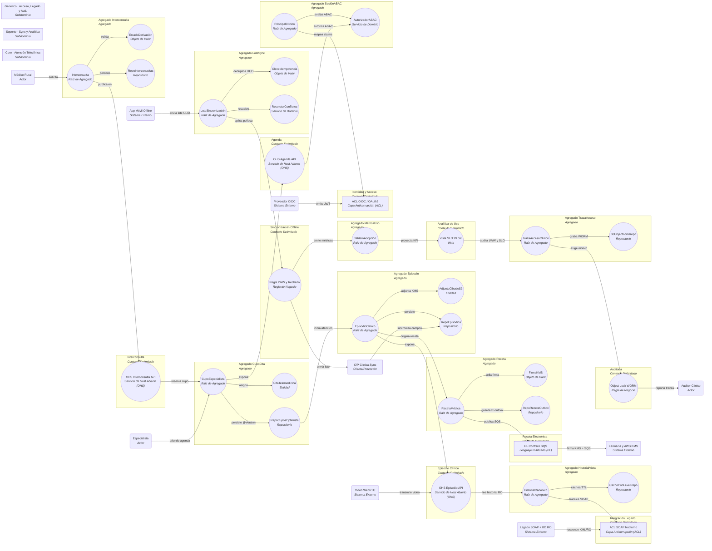
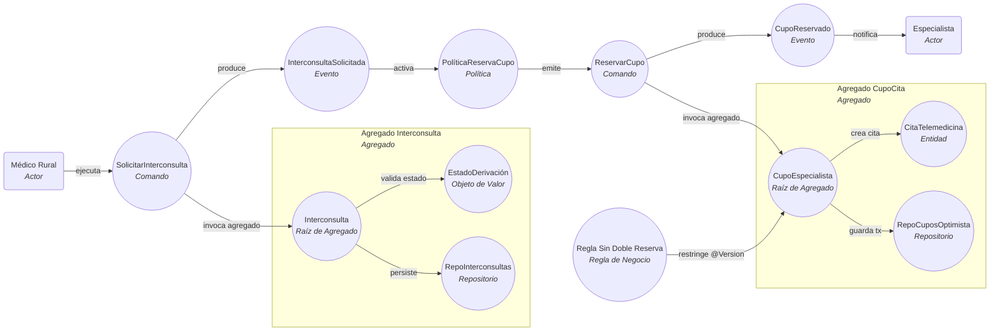
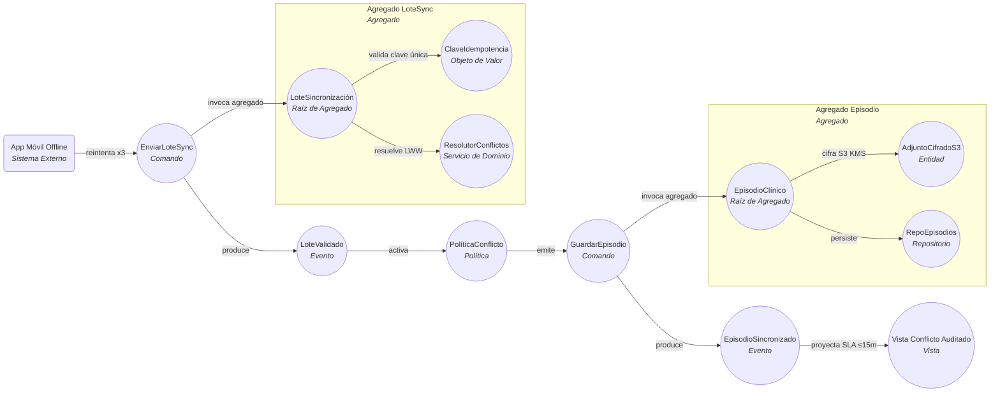
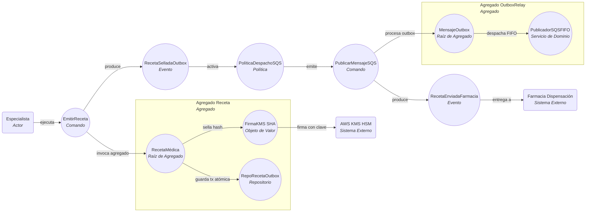
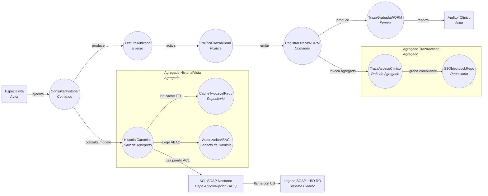

# RedSalud Andina — Diseño Estratégico y Táctico DDD / Event Storming

**Proyecto:** `redSaludAndina_DDD` · **Verificación geométrica:** `cruces: 0`, `solape: 0`, `sobreCaja: 0`, `etiquetasTapadas: 0`, aristas duplicadas limpiadas (`0` duplicados) y nodo raíz corregido (`Interconsulta`).

## 1. Mapa de Subdominios, 9 Contextos Delimitados y Agregados
| Subdominio | Contexto Delimitado | Módulo Spring Boot | Agregado y Raíz | Elementos tácticos y Mapa de Contexto |
| --- | --- | --- | --- | --- |
| **Core · Atención Teleclínica** | `Interconsulta` | `interconsulta` | `Agregado Interconsulta` (`Interconsulta` `@Version`) | `EstadoDerivación` (VO), `RepoInterconsultas`, `OHS Interconsulta API` (`⊞` → `01`) |
| **Core · Atención Teleclínica** | `Agenda` | `agenda` | `Agregado CupoCita` (`CupoEspecialista` `@Version`) | `CitaTelemedicina` (Entidad), `RepoCuposOptimista`, `OHS Agenda API` |
| **Core · Atención Teleclínica** | `Episodio Clínico` | `episodio` | `Agregado Episodio` (`EpisodioClínico`) | `AdjuntoCifradoS3` (Entidad KMS), `RepoEpisodios`, `OHS Episodio API` (`⊞` → `02`) |
| **Core · Atención Teleclínica** | `Receta Electrónica` | `receta` | `Agregado Receta` (`RecetaMédica`) | `FirmaKMS` (VO), `RepoRecetaOutbox`, `PL Contrato SQS` (`⊞` → `03`) |
| **Soporte · Sync y Analítica** | `Sincronización Offline` | `sincronizacion` | `Agregado LoteSync` (`LoteSincronización`) | `ClaveIdempotencia` (ULID), `ResolutorConflictos`, `Regla LWW y Rechazo`, `C/P Clínica-Sync` |
| **Soporte · Sync y Analítica** | `Analítica de Uso` | `analitica` | `Agregado MétricaUso` (`TableroAdopción`) | `Vista SLO 99.5%` (sobre réplica/export S3 + Athena, sin contaminar OLTP) |
| **Genérico · Acceso, Legado y Aud.** | `Identidad y Acceso` | `identidad` | `Agregado SesiónABAC` (`PrincipalClínico`) | `AutorizadorABAC` (`@PreAuthorize`), `ACL OIDC / OAuth2` |
| **Genérico · Acceso, Legado y Aud.** | `Integración Legado` | `legado` | `Agregado HistorialVista` (`HistorialCanónico`) | `CacheTwoLevelRepo` (Caffeine + ElastiCache), `ACL SOAP Nocturno` (`⊞` → `04`) |
| **Genérico · Acceso, Legado y Aud.** | `Auditoría` | `auditoria` | `Agregado TrazaAcceso` (`TrazaAccesoClínico`) | `S3ObjectLockRepo` (append-only), `Object Lock WORM` |

## 2. Vista Principal `Modelo` (DDD)

## 3. Subvista `01 · Agenda e Interconsulta` (↔ BPMN `01 · Agendamiento`)

## 4. Subvista `02 · Episodio y Sync Offline` (↔ BPMN `02 · Atención y registro`)

## 5. Subvista `03 · Receta, KMS y Outbox` (↔ BPMN `03 · Prescripción`)

## 6. Subvista `04 · ACL Legado y Auditoría` (↔ BPMN `04 · Consulta del historial`)

